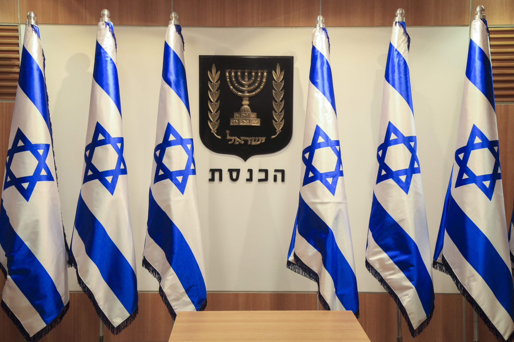

👉 **[Sign the Petition on Atzuma (Israel / Hebrew)](https://atzuma.co.il/sign/15BHXo)**

👉 **[Sign the Petition on Change.org (Global / English)](https://c.org/LgGGQJrWcQ)**

*Please prioritize the **Atzuma** link if possible, as it directly impacts domestic Israeli visibility. If you cannot read Hebrew, you may sign the **Change.org** petition instead—both represent the exact same mandate. Even better: sign both to maximize both domestic and international pressure!*

---

### **To: The Central Elections Committee of Israel, The Knesset of the State of Israel, and the Leaders of All Zionist Parliamentary Factions**

No sovereign democracy on Earth is obligated to commit national suicide by seating lawmakers who openly align with its existential enemies.

In every stable democratic nation, elected officials must swear allegiance to the state and its constitutional foundation. Yet, for years, the Israeli political arena has been subjected to a dangerous, intolerable distortion: **political parties that openly reject the State of Israel’s right to exist as a Jewish and democratic state, and whose representatives routinely praise, legitimize, or refuse to condemn terrorist organizations, continue to hold seats in the Knesset.**

This dangerous reality directly violates **Section 7A of Basic Law: The Knesset**, which explicitly and unequivocally states:

> *"A candidates' list shall not participate in elections to the Knesset, and a person shall not be a candidate for election to the Knesset, if the objects or actions of the list or the actions of the person, expressly or by implication, include one of the following:*
> 
> 1. *Negation of the existence of the State of Israel as a Jewish and democratic state;*
> 2. *Incitement to racism;*
> 3. *Support for an armed struggle of an enemy state or of a terrorist organization, against the State of Israel."*

Despite this constitutional mandate, judicial loopholes and political opportunism have repeatedly bypassed the Central Elections Committee’s disqualifications, allowing anti-Zionist lists back onto the ballot.

Furthermore, political factions seeking short-term coalition math have normalized courting these anti-Zionist parties—entertaining partnerships with entities that actively undermine the Israel Defense Forces (IDF) and advocate for the dismantling of the Jewish state.

**This institutional negligence must end now.**

### **We, the undersigned citizens of Israel and allies of the global Zionist community, demand:**

1. **Strict, Uncompromising Enforcement of Section 7A:**
   The Central Elections Committee and relevant authorities must apply the law as written, permanently barring any list or candidate that negates Israel’s identity as a Jewish state or supports armed struggle against it.

2. **Legislative Closure of Judicial Loopholes:**
   The Knesset must enact the necessary statutory amendments to ensure that the will of the legislature regarding Section 7A cannot be watered down or overturned when documented evidence of anti-Zionism and terror-sympathy exists.

3. **An Absolute Coalition Redline:**
   All political leaders, across the entire political spectrum, must sign a binding public pledge: **Zero political cooperation, reliance, or coalition agreements with any party that refuses to recognize the State of Israel as a sovereign Jewish nation-state.**

---

True democracy requires self-defense. True Arab-Jewish partnership in Israel can only be built with loyal citizens who seek shared prosperity, civil equality, and peace—**not with anti-Zionist factions that act as mouthpieces for hostile foreign interests.**

**Protect the Knesset. Uphold the Basic Law. Defend the sovereignty of the Jewish State.**

👉 **[Sign the Petition on Atzuma (Israel / Hebrew)](https://atzuma.co.il/sign/15BHXo)**

👉 **[Sign the Petition on Change.org (Global / English)](https://c.org/LgGGQJrWcQ)**

***Sufian M'Barki***
